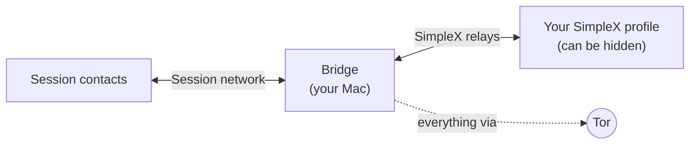

# session-simplex-bridge

**Read and answer your [Session](https://getsession.org) messages from [SimpleX Chat](https://simplex.chat), with every connection running over Tor.**

> 🧅 **Tor-only, tested and working.** Every connection the bridge makes, to Session and to SimpleX, goes through Tor. It fails closed: no direct connections, no local DNS lookups, no fallback. This has been tested on real Tor and verified at the connection level ([how to check it yourself](#verify-it-yourself)).



People keep writing to your Session ID. Every message shows up in one SimpleX chat, labelled with the sender, and whatever you answer there goes back over Session. You don't need the Session app on your phone anymore.

## Features

- **🧅 Tor-only, fail-closed:** a bundled Tor, SimpleX over `.onion` relays, every Session request forced through Tor, and seed nodes certificate-pinned. If Tor is down, nothing leaves the machine. [More below](#tor-everything-goes-through-tor).
- **Two-way:** text, photos, files and voice messages, in both directions.
- **Reply by quoting:** quote a forwarded message to answer that person. A ✅ reaction confirms delivery.
- **Nothing gets lost offline:** Session keeps messages for about 14 days, SimpleX relays hold your replies, and the bridge queues everything on disk. When the Mac comes back, it catches up in order.
- **Runs in the background:** a LaunchAgent starts it at login and restarts it if it crashes. No Terminal window needed.
- **Locked to you:** pairing uses a one-time SimpleX invitation. Only the profile that used it can control the bridge.
- **Secrets in the Keychain:** the Session recovery phrase and the database key live in the macOS Keychain. The log never contains message text.
- **No Homebrew needed.**

## Status

Early, personal-scale software: one Session account bridged to one SimpleX profile.

| Platform | Status |
|---|---|
| macOS, Intel (macOS 15) | ✅ Tested, in daily use |
| Tor-only mode (default) | ✅ Tested on real Tor and verified working: all traffic over Tor, nothing direct |
| macOS, Apple Silicon | Should work, untested |
| Linux | Should work (see [Linux](#linux)), untested |

Reports from untested platforms are very welcome. Please open an issue.

## Requirements

- A recent macOS on Intel or Apple Silicon (tested on macOS 15)
- SimpleX Chat on your phone or desktop
- A Session account, or let the bridge create a new one
- Intel Macs only: Apple's Command Line Tools (`xcode-select --install`), used to build OpenSSL once

The installer fetches everything else: [Bun](https://bun.sh), the official `simplex-chat` CLI, Tor, and OpenSSL if the CLI needs it.

## Install

```bash
git clone https://github.com/lars4/session-simplex-bridge.git ~/session-simplex-bridge
cd ~/session-simplex-bridge
./install.sh
```

The background service runs from this folder, so keep it where it is.

The installer asks two questions:

1. **New Session ID or existing account.** A new ID keeps things separate. Importing your recovery phrase keeps your existing Session ID. Messages then also arrive on any other device still logged into that account.
2. **Display name** your Session contacts see (optional).

To also forward overnight, keep the Mac awake while it's plugged in:

```bash
KEEP_AWAKE=1 ./install.sh
```

### Pair with SimpleX

The installer ends with a QR code.

1. In SimpleX, switch to the profile that should receive the messages. For a hidden profile, type its password into the chat-list search field.
2. Tap **+** → **Scan / paste link** and scan the code, or paste the link printed under it.
3. A chat called **Session** opens with a welcome message and the Session ID people can write to.

The link works once. Show it again with `bun run pair`; pair a different profile with `bun run pair --reset`.

> SimpleX may keep hidden profiles silent. If you want alerts for bridged messages, check that profile's notification settings.

## Usage

Messages arrive in the **Session** chat like this:

```
*Anna Müller* · anna  ↩︎ quote to reply
Are we still on for Friday?
```

- **Reply to someone:** quote (swipe on) one of their messages and write your answer.
- **A message without a quote** goes to the current chat. That's the last person you quoted or picked with `/to`; at the start it's the first person who writes. Messages from anyone else carry the hint `↩︎ quote to reply`.
- **Files:** send photos, files or voice messages as usual. Session accepts up to 10 MB.
- **✅** on your message means it reached Session. Failed sends are retried for 24 hours, then you get a notice.

| Command | What it does |
|---|---|
| `/to <name or Session ID> [text]` | Switch the current chat (and optionally send). A full Session ID starts a new conversation. |
| `/who` | Show the current chat |
| `/list` | All known Session contacts |
| `/name <name> <new name>` | Rename a contact's short name |
| `/id` | Show the bridge's Session ID |
| `/status` | Tor state, queues, last successful Session check |
| `/help` | Help |

To send a text that starts with `/`, write `//`.

## Tor: everything goes through Tor

This is the core of the project, not an add-on. **Tor is on by default, and the bridge has been tested and works fully over Tor:** sending, receiving, files, pairing and catching up after being offline all run through Tor.

The bridge **fails closed**. While Tor isn't connected, nothing goes out. Messages wait, and they're delivered once Tor is back. There's no "connect directly if Tor fails" path anywhere in the code.

What that means in practice:

- **No IP exposure:** Session's nodes and SimpleX's relays never see your IP address.
- **No DNS leaks:** hostnames are resolved by Tor, never by your Mac.
- **No bypass:** library requests that don't ask for a proxy are routed through Tor anyway.
- **No fake node lists:** seed-node requests are upgraded to HTTPS with pinned certificates, so a Tor exit relay can't tamper with them.

| Part | How it's routed |
|---|---|
| Tor itself | The installer downloads the official [Tor Expert Bundle](https://www.torproject.org/download/tor/) from torproject.org and checks it against a pinned SHA-256. The bridge runs it as a child process with its own data directory, waits for it to finish connecting, and restarts it if it dies. |
| SimpleX | `simplex-chat` runs with `--socks-proxy … --socks-mode always --host-mode onion`, so relays and file servers are reached through Tor, via their `.onion` addresses where available. |
| Session | Every `fetch()` in the process is forced through a local proxy that only talks to Tor's SOCKS port. Hostnames are resolved by Tor, never locally. This covers library requests that don't set a proxy themselves. |
| Session seed nodes | Session.js fetches the node list over plain HTTP. The bridge upgrades this to HTTPS on port 4443 with the seeds' pinned certificates, as Session Desktop does, so a Tor exit relay can't serve a fake node list. |

### Verify it yourself

You don't have to take this on trust. While the bridge runs, the bridge process and `simplex-chat` should only have connections to `127.0.0.1` (the local Tor). The only process talking to the internet is `tor`, and the addresses it connects to are Tor relays, not Session or SimpleX servers.

```bash
for p in $(pgrep -f "src/main.ts") $(pgrep -f "simplex-chat -p"); do lsof -nP -a -p $p -iTCP; done
lsof -nP -a -p $(pgrep -x tor) -iTCP -sTCP:ESTABLISHED
```

`/status` in the SimpleX chat also shows the current state, e.g. `Network: Tor ✅ (bundled Tor)`.

Install-time options:

| | |
|---|---|
| `TOR_SOCKS=127.0.0.1:9050 ./install.sh` | Use a Tor you already run instead of the bundled one |
| `BRIDGE_TOR=off ./install.sh` | Disable Tor and connect directly. Not recommended: your IP becomes visible. |
| `UPDATE_TOR=1 ./install.sh` | Download the Tor bundle again. To move to a newer Tor, update the version and hashes in [`scripts/fetch-tor.ts`](scripts/fetch-tor.ts) from `sha256sums-signed-build.txt`. |

## Security and privacy

Read this before relying on the bridge.

- **It breaks end-to-end encryption by design.** Messages are decrypted on the Mac and re-encrypted for the other network. Whoever controls the Mac can read them. Use FileVault and a strong login password.
- **What servers learn:** thanks to Tor, no server learns your IP. Session's service nodes (and the Tor exit in front of them) still see which Session ID is being checked and when, as with any Session client. SimpleX relays see what they always see, which is very little.
- **What's stored:**
  - **Keychain:** the Session recovery phrase and the SimpleX database passphrase.
  - **`~/Library/Application Support/session-simplex-bridge`** (mode 700): the encrypted SimpleX database, the bridge state (contact IDs and names, the pending queue) and Tor's data.
  - **Forwarded files:** deleted once they're uploaded.
- **Logs** contain metadata (shortened Session IDs, counts, errors), never message text.
- **Your SimpleX profiles stay separate.** The bridge only knows its one chat with you. It can't tell which profile that is, or whether it's hidden.
- **Back up the recovery phrase.** Show it with
  `security find-generic-password -s session-simplex-bridge -a session-mnemonic -w`
- **Unofficial library.** The Session side uses [Session.js](https://sessionjs.github.io/docs/), a third-party client library. If Session changes its protocol, the bridge may stop working until Session.js catches up (`bun update`).
- **Groups:** messages from Session closed groups are forwarded, but replying to groups isn't supported.

## Maintenance

| Task | Command |
|---|---|
| Watch the log | `tail -f ~/Library/Logs/session-simplex-bridge.log` |
| Restart | `launchctl kickstart -k gui/$(id -u)/local.session-simplex-bridge` |
| Update the bridge | `git pull && ./install.sh` |
| Update the SimpleX CLI | `UPDATE_SIMPLEX=1 ./install.sh` |
| Pair a different SimpleX profile | `bun run pair --reset` |
| Uninstall, keep data | `./uninstall.sh` |
| Uninstall and delete everything | `./uninstall.sh --purge` |

Re-running `./install.sh` is always safe. It keeps your identity, pairing and data.

## Troubleshooting

| Symptom | What to do |
|---|---|
| `simplex-chat does not start … libcrypto` | Intel Macs build OpenSSL from source. Install the Command Line Tools with `xcode-select --install`, then run `./install.sh` again. |
| No answer to `/status`, log ends with `Waiting for Tor to connect…` | The bridge waits for Tor before starting SimpleX. Check the log for `[tor]` warnings. Networks that block Tor need Tor bridges; run your own Tor configured with bridges and point `TOR_SOCKS` at it. |
| No messages arrive | Send `/status`. Check that the background item is allowed under **System Settings → General → Login Items & Extensions**. |
| The bridge chat in SimpleX was deleted | The bridge notices and creates a new pairing link. Run `bun run pair`. |

## Linux

Same code, without launchd. On x86_64:

```bash
bun install
bun run scripts/fetch-tor.ts bin/tor      # or set TOR_SOCKS to your system Tor
# put the simplex-chat CLI at bin/simplex-chat (or set SIMPLEX_BIN)
bun run setup                             # secrets go to a 0600 file
bun run start                             # run under systemd or similar
bun run pair                              # in a second terminal
```

### Configuration

All settings are environment variables:

| Variable | Default | Purpose |
|---|---|---|
| `BRIDGE_DATA_DIR` | `~/Library/Application Support/session-simplex-bridge` (macOS), `~/.local/share/session-simplex-bridge` | State, SimpleX database, Tor data |
| `BRIDGE_SECRETS` | `keychain` on macOS, else `file` | Where secrets are stored |
| `BRIDGE_TOR` | `on` | `off` disables Tor |
| `TOR_SOCKS` | unset | Use an existing Tor instead of the bundled one |
| `TOR_BIN` | `bin/tor/tor/tor` | Bundled tor binary |
| `TOR_SOCKS_PORT` | `9250` | SOCKS port of the bundled Tor (localhost) |
| `SIMPLEX_BIN` | `bin/simplex-chat` | SimpleX CLI binary |
| `SIMPLEX_PORT` | `5225` | Local WebSocket port of the CLI |
| `SIMPLEX_BOT_NAME` | `Session` | Name of the bridge chat in SimpleX |
| `POLL_INTERVAL_MS` | `5000` | How often Session is checked |
| `SEND_GIVE_UP_MS` | `86400000` | How long failed replies are retried |

## How it works

```
src/
  main.ts        startup: Tor → kill switch → Session → SimpleX → bridge
  tor.ts         runs the bundled tor and tracks its connection state
  tor-proxy.ts   local HTTP→SOCKS proxy, fetch() kill switch, seed-node pinning
  seed-certs.ts  pinned certificates of Session's seed nodes
  simplex.ts     runs simplex-chat and talks to its local WebSocket API
  bridge.ts      forwarding, reply routing, commands, retry queues
  store.ts       state on disk (atomic writes), Session.js storage adapter
  secrets.ts     Keychain / file secrets
  setup.ts       first-time setup (create or import a Session identity)
  pair.ts        shows the SimpleX pairing QR code
scripts/
  fetch-tor.ts      downloads and verifies the Tor Expert Bundle
  fetch-openssl.ts  provides libcrypto for simplex-chat without Homebrew
```

Every incoming message is written to disk before it's forwarded, and replies are queued until Session confirms them. Session.js records which messages it has already seen, so a restart never forwards anything twice.

Type-check with `bun run check`.

## License

[MIT](LICENSE).

This repository contains only the bridge's own code. The installer downloads these on the user's machine, under their own licenses:

- [SimpleX Chat CLI](https://github.com/simplex-chat/simplex-chat) (AGPL-3.0)
- [Tor](https://gitlab.torproject.org/tpo/core/tor) (BSD-3-Clause)
- [OpenSSL](https://github.com/openssl/openssl) (Apache-2.0)
- the npm packages listed in `package.json`

The bridge talks to the SimpleX CLI over its local WebSocket API and doesn't link to it.

Not affiliated with the Session or SimpleX Chat projects.
